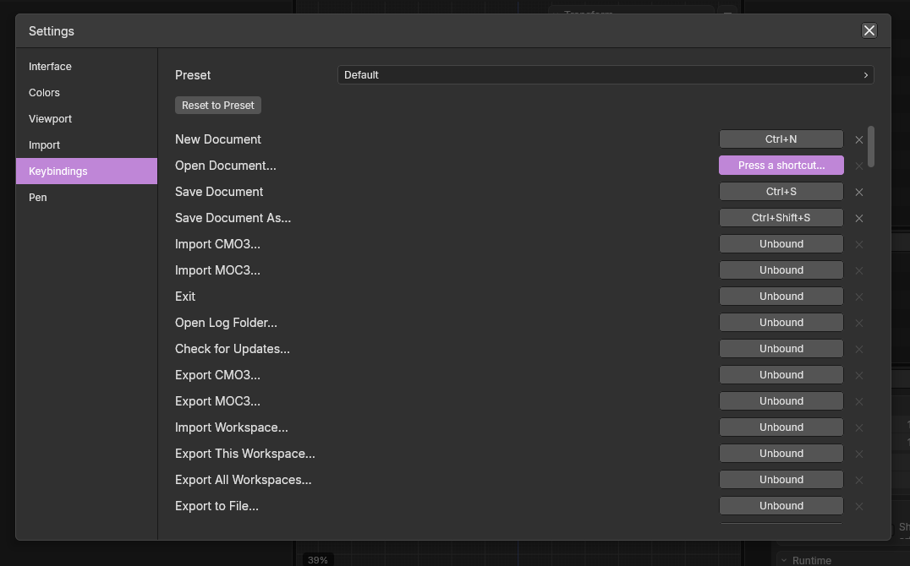

******
Keymap
******

The keymap is the list of keyboard shortcuts mapped tp a command.  Umamo comes with three, and you can change any binding.  Every command can be run without a key, from the menus or the command palette, so a keybind is a shortcut and never the only way.

How Bindings Work
=================

A binding connects a **chord** to a **command**.  A chord is a key and the modifier keys held down simultaneously : :kbd:`G`, :kbd:`Ctrl-S`, :kbd:`Shift-Alt-Z`.

* **One chord runs one command.**  A command can have more than one chord, such as the two that open the command palette.
* **A binding names a key by its position.**  The shortcut stays on the same physical key, whatever the layout of your keyboard.  The letters in this manual and in Umamo's menus name keys by their place on a US QWERTY keyboard.
* **The primary modifier changes with the system.**  Where this manual writes :kbd:`Ctrl`, it means :kbd:`Ctrl` on Windows and Linux and :kbd:`Cmd` on macOS.  A binding can also ask for the Control key itself, which is how Toggle Pose Mode keeps :kbd:`Ctrl-Tab` on macOS, where :kbd:`Cmd-Tab` belongs to the system.
* **Shortcuts act where the pointer is.**  See `Context`_.
* **A text field takes the keys.**  While you type into a field, such as the search box of the Outliner, the keys go to the field and no shortcut runs.

The shortcut of a command is shown at the right end of its menu row, in the command palette, and in the hints of the status bar.

Presets
=======

A preset is a complete keymap to start from.  Choose one in Quick Setup, or in the :guilabel:`Keybindings` category of Settings.  See :doc:`/interface/settings`.  Switching presets keeps the changes you have made to single bindings, because they are laid over whichever preset is chosen.

Default
-------

A compact set, borrowed from Blender.  Tools have a key of their own: :kbd:`G` grabs, :kbd:`R` rotates, :kbd:`S` scales, :kbd:`Tab` toggles Edit Mode, and :kbd:`Ctrl-Tab` toggles Pose Mode.  :kbd:`A` selects all, :kbd:`H` hides, and :kbd:`1`, :kbd:`2`, and :kbd:`3` change the select mode.  The command palette is on :kbd:`Ctrl-P` and :kbd:`Space`, and zooming is on :kbd:`Ctrl-Equals` and :kbd:`Ctrl-Minus`.

This manual describes the default preset.  :doc:`/appendices/default_shortcuts` lists every binding of the three.

Cubism
------

For people who come from the Cubism Editor.  It is much smaller.  It keeps the shortcuts that work across the application: the file commands, undo and redo with both :kbd:`Ctrl-Shift-Z` and :kbd:`Ctrl-Y`, :kbd:`Ctrl-0` to fit the view, and the keying keys.  The command palette is on :kbd:`Ctrl-P` only, because Cubism uses :kbd:`Space` for panning.  It leaves the single-key tools and :kbd:`Tab` unassigned.  See :doc:`/getting_started/coming_from_cubism`.

Blender
-------

For people who come from Blender.  It is the default preset with Blender's choices where they differ: the command palette is on :kbd:`F3`, :kbd:`Equals` and :kbd:`Minus` zoom without the modifier, and :kbd:`Home` frames everything.

The three differ like this:

.. list-table::
	:header-rows: 1

	* - Command
	  - Default
	  - Cubism
	  - Blender
	* - Command palette
	  - :kbd:`Ctrl-P`, :kbd:`Space`
	  - :kbd:`Ctrl-P`
	  - :kbd:`F3`
	* - Toggle Edit Mode
	  - :kbd:`Tab`
	  - —
	  - :kbd:`Tab`
	* - Redo
	  - :kbd:`Ctrl-Shift-Z`
	  - :kbd:`Ctrl-Shift-Z`, :kbd:`Ctrl-Y`
	  - :kbd:`Ctrl-Shift-Z`
	* - Grab, Rotate, Scale
	  - :kbd:`G`, :kbd:`R`, :kbd:`S`
	  - —
	  - :kbd:`G`, :kbd:`R`, :kbd:`S`
	* - Fit View
	  - :kbd:`Ctrl-0`
	  - :kbd:`Ctrl-0`
	  - —
	* - Frame Selected
	  - :kbd:`NumpadDecimal`
	  - :kbd:`Ctrl-Shift-0`
	  - :kbd:`NumpadDecimal`
	* - Zoom In, Zoom Out
	  - :kbd:`Ctrl-Equals`, :kbd:`Ctrl-Minus`
	  - :kbd:`Ctrl-Equals`, :kbd:`Ctrl-Minus`
	  - :kbd:`Equals`, :kbd:`Minus`

Editing Bindings
================

:guilabel:`Keybindings` in Settings lists every command that has a name, with its shortcut at the right.

To change a shortcut:

#. Click the shortcut of the command.  It reads ``Press a shortcut…``.
#. Press the keys you want.
#. If the keys already run another command, Umamo asks: ``Ctrl+S is already bound to “Save Document”.  Reassign it?``  :guilabel:`Reassign` gives the keys to this command, and the other command loses them.  Cancel keeps things as they were.

Press :kbd:`Escape` on its own to give up without a change.  A modifier key on its own is not a chord, so Umamo waits for the key that goes with it.

The small button at the right of a row clears the shortcut, and it reads :guilabel:`Unbound` afterwards.  The row shows one shortcut for a command, the first it has.  Changing it replaces that one, and a command's other shortcuts stay.

:guilabel:`Reset to Preset` removes every change you made and goes back to the preset as it comes.  It keeps the preset you chose.

Where Overrides Are Stored
==========================

The preset is saved in your settings file as ``input.keybinding.preset``, and your changes as ``input.keybinding.overrides``.  Overrides are a list of chords, each with the command it runs.  A chord with an empty command is unbound: it hides a chord of the preset.

.. code-block:: json

	{
		"input": {
			"keybinding": {
				"preset": "default",
				"overrides": {
					"primary+shift+KeyS": "file.saveAs",
					"Tab": ""
				}
			}
		}
	}

``primary`` is the primary modifier, ``ctrl`` is the Control key itself, and keys are named by position: ``KeyS``, ``Digit1``, ``F9``, ``Tab``, ``ArrowLeft``, ``NumpadAdd``.  The dotted names of the commands are the ones that the command palette also searches.  See :doc:`/getting_started/configuration`.

Keys That Cannot Be Rebound
===========================

Some keys belong to Umamo while something is going on, and they do not follow the keymap then.  The keymap is consulted last.

* :kbd:`Escape` and :kbd:`Enter` answer dialogs, cancel and confirm a transform in progress, and close menus and windows.  See :doc:`/interface/window_system`.
* :kbd:`X` and :kbd:`Z` lock the axis during a grab or a scale.
* :kbd:`1` to :kbd:`8` pick from an open pie menu.  See :doc:`/interface/pie_menus`.
* Every key goes to a shortcut that is being captured, to a text field that is being typed in, and to an open menu.

You can bind these keys to commands, and they will work whenever none of the above is going on.  A bare :kbd:`Escape` cannot be captured in the Keybindings editor, because it cancels the capture.  A modifier on its own, and keys without a name in Umamo, such as media keys, cannot be bound.

Context
=======

A chord runs the same command everywhere, but the command may do different things in different places.

* **The area under the pointer.**  :kbd:`G` grabs vertices in the 2D Viewport and UVs in the UV Editor.  :kbd:`Shift-S` opens the Snap pie in one and the UV Snap pie in the other.  The zoom and framing keys work on the area that has the pointer.  See :doc:`/interface/window_system`.
* **The mode.**  A command only runs when it applies.  The keys for vertex tools do nothing in Object Mode.
* **What is in progress.**  A modal operation, an open pie menu, or an armed tool takes the keys first.

The command palette, and the hints in the status bar, show the commands of the area under the pointer.  See :doc:`/interface/command_palette` and :doc:`/interface/status_bar`.

.. seealso::

	* :doc:`/interface/settings`
	* :doc:`/appendices/default_shortcuts`
	* :doc:`/interface/command_palette`
	* :doc:`/getting_started/coming_from_cubism`
